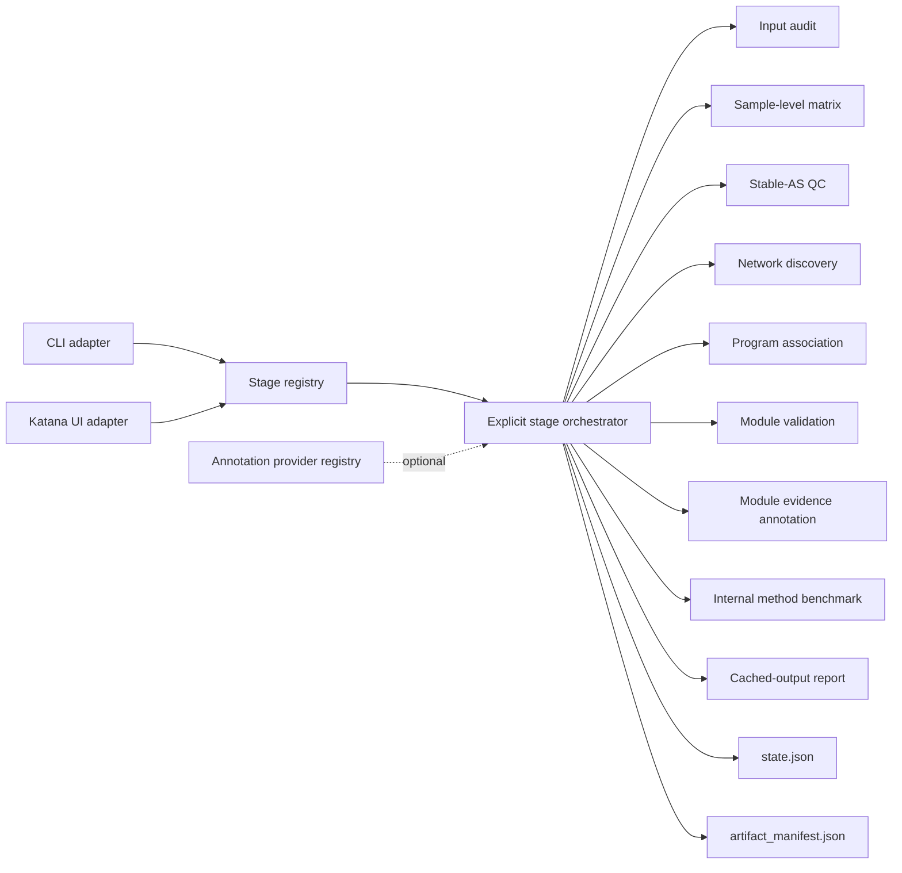

# Katana-CoSplice Architecture

Katana-CoSplice is designed as one reusable analysis engine with two adapters:

- the standalone `katana-cosplice` CLI;
- the embedded Katana desktop page.

Both adapters consume the same stage registry and pipeline. They do not maintain separate analysis logic.

## Design goals

1. **Explicit execution**: opening a page, switching a tab, or reading status never starts analysis.
2. **No hidden chaining**: a stage may read an existing upstream artifact, but it never runs a missing upstream stage.
3. **Auditable artifacts**: every stage declares expected outputs and records actual outputs in `artifact_manifest.json`.
4. **Algorithm isolation**: matrix construction, QC, networking, association, and validation remain separate computational modules.
5. **Official WGCNA/TOM production backbone**: R WGCNA signed adjacency, exact TOM, Dynamic Tree Cut and eigengene merging define each partition.
6. **Backbone confidence annotation**: condition-stratified bootstrap estimates event co-assignment and confidence without changing WGCNA membership; low-confidence events remain assigned and are explicitly flagged.
7. **Extension without fabrication**: DEG, DTU, RBP, motif, and GO/KEGG support use provider contracts. An unavailable provider reports that it is not configured; it does not emit placeholder evidence.
8. **Leakage-safe validation**: preservation and functional enrichment are downstream validation endpoints and do not define production module membership. Historical multi-objective runs remain reproducible as research ablations.

## Layers



## Stage contract

Each `StageSpec` defines:

- a stable `key` used by state, cache, CLI, and UI;
- a user-facing title and scientific description;
- required and optional dependencies;
- expected artifacts and their types;
- whether it accepts `force`;
- the explicit-only execution policy.

Dependencies are validation contracts, not execution instructions. For example, `stable_qc` declares `matrix` as a dependency. If matrix artifacts do not exist, `stable_qc` reports the missing input and stops. It does not run `matrix`.

The only chained entry point is the user-invoked `katana-cosplice run` command. UI buttons and `katana-cosplice stage --name ...` always execute exactly one stage.

## Registered stages

| Stage | Required cached input | Main responsibility |
|---|---|---|
| `audit` | Raw project inputs | Resolve paths and sample identity |
| `matrix` | Raw rMATS and metadata | Build PSI/IJC/SJC matrices |
| `stable_qc` | `matrix` | Select stable, read-supported events |
| `network_observed` | `stable_qc` | Discover observed co-splicing modules |
| `network_residual` | `stable_qc` | Discover covariate-residualized modules |
| `consensus_modules` | `network_observed`; optional predeclared tuning inputs | Preserve the WGCNA partition and annotate event/module bootstrap confidence; historical repartitioning modes remain reproducible only by explicit configuration |
| `hybrid_programs` | legacy benchmark only | Deprecated compatibility implementation; hidden from the production UI and default pipeline |
| `associate_observed` | `network_observed` | Associate observed program scores with metadata |
| `associate_residual` | `network_residual` | Associate residual program scores with metadata |
| `validate_modules` | `network_observed` | Bootstrap and sensitivity validation |
| `annotate_modules` | `network_observed` | Add cached DEG/DTU/RBP support without changing modules |
| `benchmark_methods` | `stable_qc` | Compare methods on one fixed stable-event universe |
| `preserve_modules` | `consensus_modules` | Test consensus modules in configured external cohorts |
| `factor_contrasts` | `stable_qc`; configured network cache | Test predeclared factor, perturbation and interaction hypotheses without causal overclaiming |
| `differential_network` | `network_observed`; `consensus_modules` | Compare fixed-module density and topology across metadata conditions |
| `multiview_fusion` | `network_observed`; configured event features | Reweight existing AS edges with optional evidence layers |
| `bayesian_preservation` | `preserve_modules` | Combine external-cohort preservation evidence hierarchically |
| `report` | Existing cached outputs, all optional | Summarize provenance without recomputation |

## Artifact and cache contract

`state.json` is the lightweight UI status source. `artifact_manifest.json` is the reproducibility inventory. For each executed stage it records:

- stage status and message;
- parameter/input fingerprint;
- declared dependencies;
- expected artifact contract;
- generated files, file type, existence, size, and modification time.

Running a stage with unchanged inputs and parameters may produce `cache_hit`. A status refresh only reads these files.

The matrix stage records source selection and integrity checks so duplicate sample identities, ambiguous condition BAM lists, invalid PSI ranges, and negative junction counts fail before network construction. Stable-AS keeps a full event-level audit while limiting the larger event-by-condition detail table to final passing events.

## Annotation extension points

The core PSI network does not require mechanism annotations. Optional providers are intentionally downstream:

| Provider | Scope | Purpose |
|---|---|---|
| DEG | gene | Add expression support without redefining AS modules |
| DTU | gene/transcript | Add isoform-usage support |
| RBP | gene/module | Prioritize plausible RBP-linked programs |
| Motif | event/module | Test sequence enrichment near regulated regions |
| GO/KEGG | module gene set | Describe module-level biological functions |

`annotate_modules` consumes cached
`gene_level_integrated_candidates.tsv` files through `support_root`, plus the built-in or an optional
custom RBP gene set. It produces unique module-gene support, module-level enrichment and a source
audit. It never starts candidate screening and never changes event-module assignments. Motif
scanning requires an indexed genome FASTA plus ATtRACT or compatible PWM input. GO/KEGG enrichment
uses configured local GMT files or the validated g:Profiler provider; absence of a database is
recorded rather than replaced with fabricated annotations.

External cohort PSI matrices can be configured explicitly for `preserve_modules`; missing targets
are recorded in the target audit and are never replaced with discovery-cohort data. The standalone
locked-validation adapter additionally fits module PC1 loadings in discovery cohorts, projects those
fixed loadings into one untouched phenotype-annotated cohort, performs complete-cohort and
patient-matched phenotype tests, and runs validation module discovery on the locked discovery-event
union. It does not rank validation events or tune network parameters. Preservation, phenotype
association and functional-theme replication are separate evidence layers and are never collapsed
into a causal claim.

## Multi-objective validation audit

In the production `backbone_confidence_only` mode, WGCNA alone defines the
partition. The optional `multiobjective_selection` configuration evaluates the
fixed partition on three objectives but cannot change membership:

1. internal stability from the lower-tail-aware bootstrap ARI composite;
2. external preservation across predeclared tuning cohorts, combining module density,
   connectivity, membership-profile/program preservation and exact-event coverage;
3. functional coherence from module-level hypergeometric enrichment against a versioned tuning
   GMT, with within-module BH-FDR and annotation coverage.

The combined score is retained as an audit metric, not a production-selection
target. A near-zero objective therefore remains visible rather than being
hidden by another metric. Historical `backbone_refined_consensus` and legacy
candidate-partition modes may still use the selector when explicitly requested
to reproduce an older run.

`tuning_cohorts` and `holdout_cohorts` must be disjoint. Only tuning PSI matrices are loaded by
`consensus_modules`; holdout paths are not read. The fixed partition, objective
values and per-module/cohort contributions are exported in
`consensus_parameter_search.tsv`, `multiobjective_selection_audit.tsv` and `parameters.json`.
Using a GMT during selection makes enrichment against that same GMT a tuning result, not independent
functional validation. Publication claims require an untouched cohort and preferably an independent
functional source after the partition has been locked.

## Internal method benchmark

`benchmark_methods` selects one deterministic event universe from the cached Stable-AS
`stability_score` before fitting any benchmark method. Every available method receives the same
events and samples. The default cap is 150 events because exact partial-correlation estimation scales
poorly when event count greatly exceeds sample count; this cap applies only to the benchmark and
never truncates the production CoSplice network.

Outputs include method availability, event assignments, module matching, condition-stratified
bootstrap ARI, neutral module-quality metrics, runtime, plots, parameters, and an HTML interpretation
report. Degenerate results such as zero or one retained module are explicitly labelled and do not
receive a misleading perfect stability score. This remains an internal same-cohort benchmark;
independent-cohort preservation is required before claiming general biological superiority.

## Public API

```python
from katana_cosplice import (
    AnnotationRegistry,
    CoSplicePipeline,
    CoSpliceProject,
    load_config,
    stage_specs,
)

pipeline = CoSplicePipeline(load_config("cosplice_config.yaml"))
pipeline.run_stage("matrix")

project = CoSpliceProject.open("cosplice_config.yaml")
print(project.stages())
```

The standalone package and Katana integration use this same API.

## Planned extensions

The architecture reserves annotation providers and external validation adapters, but their presence in the registry is not a claim that the analysis exists. A provider becomes available only after it has a real implementation, tests, documented inputs, and declared outputs.
