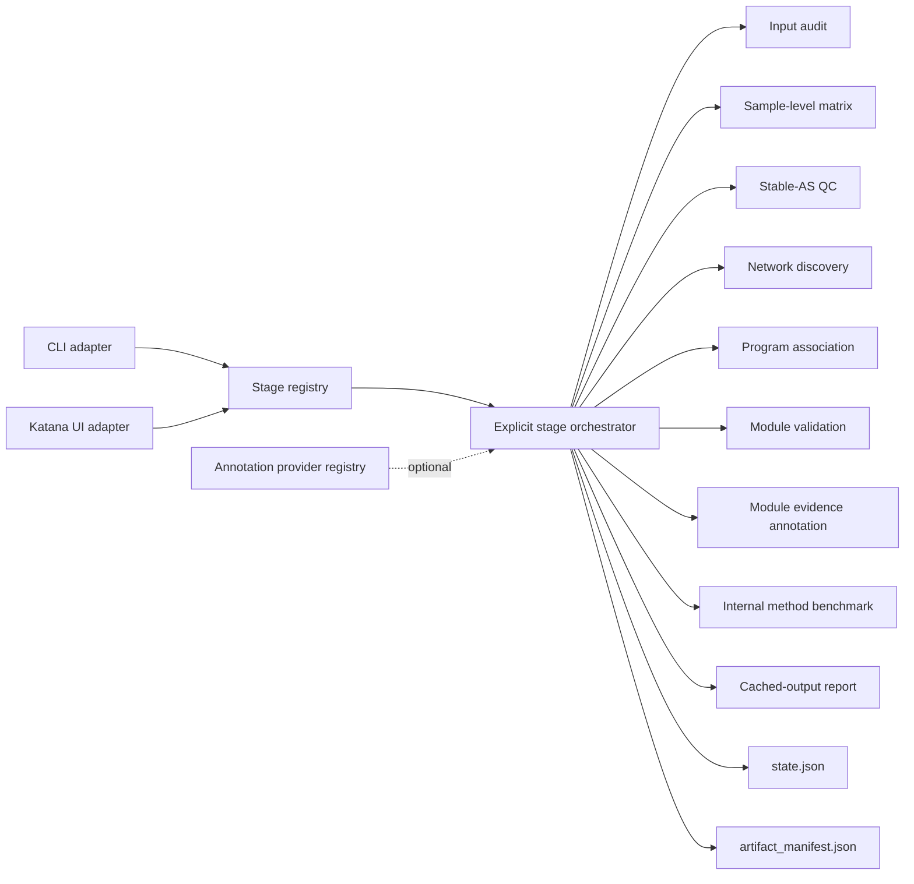

# Katana-CoSplice Architecture

Katana-CoSplice is designed as one reusable analysis engine with two adapters:

- the standalone `katana-cosplice` CLI;
- the embedded Katana desktop page.

Both adapters consume the same stage registry and pipeline. They do not maintain separate analysis logic.

## Design goals

1. **Explicit execution**: opening a page, switching a tab, or reading status never starts analysis.
2. **No hidden chaining**: a stage may read an existing upstream artifact, but it never runs a missing upstream stage.
3. **Auditable artifacts**: every stage declares expected outputs and records actual outputs in `artifact_manifest.json`.
4. **Algorithm isolation**: matrix construction, QC, networking, association, and validation remain separate computational modules.
5. **Auditable WGCNA-style refinement**: sparse community discovery is followed by module-program merging and kME-style membership rejection; original and final assignments are both exported.
6. **Resampling-selected consensus**: outer bootstrap co-assignment is partitioned by sparse Leiden parameter search, and core/peripheral/grey membership remains explicit.
7. **Extension without fabrication**: DEG, DTU, RBP, motif, and GO/KEGG support use provider contracts. An unavailable provider reports that it is not configured; it does not emit placeholder evidence.

## Layers



## Stage contract

Each `StageSpec` defines:

- a stable `key` used by state, cache, CLI, and UI;
- a user-facing title and scientific description;
- required and optional dependencies;
- expected artifacts and their types;
- whether it accepts `force`;
- the explicit-only execution policy.

Dependencies are validation contracts, not execution instructions. For example, `stable_qc` declares `matrix` as a dependency. If matrix artifacts do not exist, `stable_qc` reports the missing input and stops. It does not run `matrix`.

The only chained entry point is the user-invoked `katana-cosplice run` command. UI buttons and `katana-cosplice stage --name ...` always execute exactly one stage.

## Registered stages

| Stage | Required cached input | Main responsibility |
|---|---|---|
| `audit` | Raw project inputs | Resolve paths and sample identity |
| `matrix` | Raw rMATS and metadata | Build PSI/IJC/SJC matrices |
| `stable_qc` | `matrix` | Select stable, read-supported events |
| `network_observed` | `stable_qc` | Discover observed co-splicing modules |
| `network_residual` | `stable_qc` | Discover covariate-residualized modules |
| `consensus_modules` | `network_observed` | Define final modules from bootstrap event co-assignment |
| `hybrid_programs` | `stable_qc`, `network_observed` | Retain tight sparse and diffuse soft-TOM programs with internal/external confidence |
| `associate_observed` | `network_observed` | Associate observed program scores with metadata |
| `associate_residual` | `network_residual` | Associate residual program scores with metadata |
| `validate_modules` | `network_observed` | Bootstrap and sensitivity validation |
| `annotate_modules` | `network_observed` | Add cached DEG/DTU/RBP support without changing modules |
| `benchmark_methods` | `stable_qc` | Compare methods on one fixed stable-event universe |
| `preserve_modules` | `consensus_modules` | Test consensus modules in configured external cohorts |
| `factor_contrasts` | `stable_qc`; configured network cache | Test predeclared factor, perturbation and interaction hypotheses without causal overclaiming |
| `report` | Existing cached outputs, all optional | Summarize provenance without recomputation |

## Artifact and cache contract

`state.json` is the lightweight UI status source. `artifact_manifest.json` is the reproducibility inventory. For each executed stage it records:

- stage status and message;
- parameter/input fingerprint;
- declared dependencies;
- expected artifact contract;
- generated files, file type, existence, size, and modification time.

Running a stage with unchanged inputs and parameters may produce `cache_hit`. A status refresh only reads these files.

The matrix stage records source selection and integrity checks so duplicate sample identities, ambiguous condition BAM lists, invalid PSI ranges, and negative junction counts fail before network construction. Stable-AS keeps a full event-level audit while limiting the larger event-by-condition detail table to final passing events.

## Annotation extension points

The core PSI network does not require mechanism annotations. Optional providers are intentionally downstream:

| Provider | Scope | Purpose |
|---|---|---|
| DEG | gene | Add expression support without redefining AS modules |
| DTU | gene/transcript | Add isoform-usage support |
| RBP | gene/module | Prioritize plausible RBP-linked programs |
| Motif | event/module | Test sequence enrichment near regulated regions |
| GO/KEGG | module gene set | Describe module-level biological functions |

`annotate_modules` is the first implemented provider-backed stage. It consumes cached
`gene_level_integrated_candidates.tsv` files through `support_root`, plus the built-in or an optional
custom RBP gene set. It produces unique module-gene support, module-level enrichment and a source
audit. It never starts candidate screening and never changes event-module assignments. Motif,
GO/KEGG remains unavailable until its required databases are configured and validated. External
cohort PSI matrices can be configured explicitly for `preserve_modules`; missing targets are recorded
in the target audit and are never replaced with discovery-cohort data.

## Internal method benchmark

`benchmark_methods` selects one deterministic event universe from the cached Stable-AS
`stability_score` before fitting any benchmark method. Every available method receives the same
events and samples. The default cap is 150 events because exact partial-correlation estimation scales
poorly when event count greatly exceeds sample count; this cap applies only to the benchmark and
never truncates the production CoSplice network.

Outputs include method availability, event assignments, module matching, condition-stratified
bootstrap ARI, neutral module-quality metrics, runtime, plots, parameters, and an HTML interpretation
report. Degenerate results such as zero or one retained module are explicitly labelled and do not
receive a misleading perfect stability score. This remains an internal same-cohort benchmark;
independent-cohort preservation is required before claiming general biological superiority.

## Public API

```python
from katana_cosplice import (
    AnnotationRegistry,
    CoSplicePipeline,
    CoSpliceProject,
    load_config,
    stage_specs,
)

pipeline = CoSplicePipeline(load_config("cosplice_config.yaml"))
pipeline.run_stage("matrix")

project = CoSpliceProject.open("cosplice_config.yaml")
print(project.stages())
```

The standalone package and Katana integration use this same API.

## Planned extensions

The architecture reserves annotation providers and external validation adapters, but their presence in the registry is not a claim that the analysis exists. A provider becomes available only after it has a real implementation, tests, documented inputs, and declared outputs.
